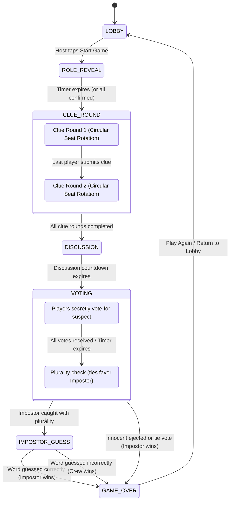

# Impostor 🕵️‍♂️🎭

A decentralized, zero-cloud, local-multiplayer social deduction party game inspired by *The Chameleon* and *Spyfall*.

Built with **Flutter** (Material 3 + Riverpod) on the frontend and an **embedded Python 3.12 asynchronous engine** running locally on-device.

---

## 🌟 Overview & Core Philosophy

In **Impostor**, all players receive a secret word belonging to a chosen category—**except the Impostor(s)**, who only see the category (or nothing, depending on difficulty settings). Players take turns giving subtle, one-word clues to prove their innocence without giving the word away to the Impostor. After discussion and voting, the crew attempts to unmask the Impostor, while caught Impostors get a chance to steal victory by guessing the secret word.

### Key Pillars:
- **100% Offline & Local**: Runs entirely over local Wi-Fi, personal hotspot, or on a single device. Zero external cloud servers, zero subscription, and zero telemetry.
- **Embedded Python Server**: The host device embeds a full CPython runtime (`serious_python`) serving low-latency WebSockets directly to peers.
- **Custom Data Structures & Algorithms (DSA)**: Turn rotation, deadline timers, action queues, and room lookup tables are built from scratch in pure Python with theoretical time/space guarantees.
- **Zero-Friction Joining**: Dynamic QR code generation and camera scanning (`impostor://join?ip=...&port=...&room=...`) for instant 2-second lobby joins.

---

## 🎮 Game Modes

### 1. LAN Multiplayer (Host & Join via Wi-Fi / Hotspot)
- **Host**: Launches an embedded WebSocket game server on port `8765` directly on their phone with an active Android Foreground Service & WakeLock.
- **Joiners**: Other players on the same Wi-Fi or portable hotspot join instantly by scanning the host's on-screen QR code or entering the IP and 4-letter room code.
- **Synchronized Play**: Real-time state synchronization, live clue logs, voting tallies, and countdown timers across all devices.

### 2. Pass & Play (Single Device)
- **Offline Party Mode**: Ideal for road trips, cafes, or gatherings where only one phone is available.
- **Privacy Curtains**: "Pass the phone to [Player]" privacy barriers prevent screen peeking.
- **Spoken or Typed Clues**: Supports oral table discussion where players say their clue out loud and tap **Done**, or traditional secret typed clues.
- **Private Voting & Role Reveal**: Each player secretly views their role and casts their vote in rotation before the device is passed back to the group.

---

## 🏛️ System Architecture

```
       +-----------------------------------------------------------+
       |                     Host Mobile Device                    |
       |                                                           |
       |  +--------------------+         +----------------------+  |
       |  | Flutter Client     |         | Foreground Service   |  |
       |  | (Host UI & Lobby)  |         | & WakeLock           |  |
       |  +---------+----------+         +----------------------+  |
       |            |                                              |
       |            | Loopback Control Channel (127.0.0.1:8766)    |
       |            | AUTH <token> -> START / STOP / STATUS / QUIT |
       |            v                                              |
       |  +-----------------------------------------------------+  |
       |  | Python Supervisor Daemon (server/embedded_entry.py) |  |
       |  | - Single asyncio event loop (Process Singleton)     |  |
       |  | - Dynamically manages GameServer lifecycle          |  |
       |  |                                                     |  |
       |  |   +----------------------------------------------+  |  |
       |  |   | WebSocket GameServer (server/main.py)        |  |  |
       |  |   | - Listens on 0.0.0.0:8765                    |  |  |
       |  |   | - Connection tracking & heartbeat ticker     |  |  |
       |  |   | - Custom DSA Engine (engine/game.py)         |  |  |
       |  |   +----------------------------------------------+  |  |
       |  +-----------------------------------------------------+  |
       +----------------------------+------------------------------+
                                    |
                                    | Local Wi-Fi / Hotspot
                                    | WebSocket (ws://<HOST_IP>:8765)
                                    v
     +------------------------------+-------------------------------+
     |                                                              |
+----+----------------------+                    +------------------+----+
| Client Device 1           |                    | Client Device 2           |
| (Flutter Joiner via QR)   |                    | (Flutter Joiner via IP)   |
+---------------------------+                    +---------------------------+
```

### Architectural Highlights
- **Process Singleton Supervisor**: Because CPython cannot be reinitialized inside an active mobile process, a long-lived Python supervisor daemon runs on loopback (`127.0.0.1:8766`). The Flutter host issues authenticated IPC commands (`START`, `STOP`, `STATUS`, `QUIT`) with a cryptographically secure token.
- **Battery & Sleep Protection**: When hosting, Flutter registers an Android Foreground Notification task and acquires CPU/Wi-Fi WakeLocks so the game server doesn't get throttled when the screen dims.
- **Leak-Proof Client Views**: Outgoing WebSocket frames are scrubbed using role-based projection. The server never leaks the Impostor identity to crew members, and never broadcasts the secret word to the Impostor until the game reaches `GAME_OVER`.

---

## 🧩 Core Data Structures & Algorithms (DSA)

All core structures inside `engine/structures/` are implemented from scratch in pure Python with no external library shortcuts (e.g., no `heapq` or `collections.deque`):

| Data Structure | Implementation File | Role in Impostor | Time Complexity | Space Complexity |
| :--- | :--- | :--- | :--- | :--- |
| **Circular Doubly-Linked List** | `engine/structures/circular_linked_list.py` | Turn order and clue-turn rotation | `append`: $O(1)$<br>`remove`: $O(n)$ search, $O(1)$ unlink<br>`next`: $O(1)$<br>`peek`: $O(1)$ | $O(n)$ total, $O(1)$ per node |
| **Index-Tracked Min-Heap** | `engine/structures/min_heap.py` | Expiry timers for turn, discussion, and voting | `push`: $O(\log n)$<br>`pop_min`: $O(\log n)$<br>`remove(id)`: $O(\log n)$<br>`peek`: $O(1)$ | $O(n)$ array + $O(n)$ hash map |
| **Singly-Linked FIFO Queue** | `engine/structures/queue.py` | Sequential per-room incoming action pipeline | `enqueue`: $O(1)$<br>`dequeue`: $O(1)$<br>`peek`: $O(1)$ | $O(n)$ total, $O(1)$ per node |
| **Chained Hash Table** | `engine/structures/hash_table.py` | Room registry (`room_code` $\to$ `GameEngine`) | `put`: Avg $O(1)$, Worst $O(n)$<br>`get`: Avg $O(1)$, Worst $O(n)$<br>`remove`: Avg $O(1)$, Worst $O(n)$ | $O(n + m)$ dynamic resizing ($\alpha > 0.75$) |

### Specialized DSA Features:
1. **Remove-While-Iterating Guarantee**: In `CircularLinkedList`, if a player disconnects or is kicked during their active turn, the list detects cursor overlap and shifts `_current` to `target.next` prior to unlinking, guaranteeing zero pointer corruption.
2. **Index-Tracked Arbitrary Timer Cancellation**: Standard heaps require $O(n)$ scan to cancel scheduled timers. Our `MinHeap` tracks item positions with an internal map (`_id_to_index`), enabling $O(\log n)$ cancellation when a player submits a clue early.

---

## 🔄 Game Loop & State Machine



---

## 📂 Project Structure

```
imposter/
├── app/                              # Flutter Mobile Application
│   ├── android/                      # Android Gradle project & permissions
│   ├── assets/                       # Embedded runtime assets
│   │   ├── app.zip                   # Pre-bundled Python engine & websockets
│   │   └── app.zip.hash              # SHA-256 integrity hash
│   ├── lib/
│   │   ├── core/                     # Constants, colors, and dark theme
│   │   ├── models/                   # Protocol & QR payload data models
│   │   ├── screens/                  # Flutter UI screens
│   │   │   ├── home_screen.dart      # Main landing & mode selection
│   │   │   ├── lobby_screen.dart     # Room settings & QR display
│   │   │   ├── qr_scanner_screen.dart# Camera scanner for joining
│   │   │   ├── role_reveal_screen.dart# Word / Impostor role reveal
│   │   │   ├── clue_round_screen.dart# Clue submission & turn tracker
│   │   │   ├── discussion_screen.dart# Discussion countdown & clue review
│   │   │   ├── voting_screen.dart    # Player voting interface
│   │   │   ├── pass_and_play_*.dart  # Offline single-device controller & UI
│   │   │   └── embedded_server_debug_screen.dart # Supervisor diagnostics
│   │   ├── services/
│   │   │   ├── game_client.dart      # WebSocket client communicating with server
│   │   │   ├── host_service.dart     # Supervisor launcher & foreground task
│   │   │   ├── host_control_client.dart # IPC client for 127.0.0.1:8766
│   │   │   └── network_ip_helper.dart# Local Wi-Fi/Hotspot IP discovery
│   │   ├── state/                    # Riverpod state providers
│   │   └── widgets/                  # Reusable components (curtains, timers)
│   ├── test/                         # Flutter widget & unit test suite
│   └── pubspec.yaml                  # Flutter dependencies
│
├── engine/                           # Pure Python 3.12 Game Engine
│   ├── game.py                       # GameEngine state machine
│   ├── models.py                     # Phase, Role, Player, and Settings models
│   ├── protocol.py                   # Input validation & privacy view filtering
│   ├── words.py                      # Curated categories & secret words library
│   └── structures/                   # Custom DSA implementations
│       ├── circular_linked_list.py   # Seating & turn cycle
│       ├── min_heap.py               # Expiry priority queue
│       ├── queue.py                  # Action FIFO queue
│       └── hash_table.py             # Room registry
│
├── server/                           # Asynchronous WebSocket Server
│   ├── main.py                       # GameServer (port 8765)
│   ├── embedded_entry.py             # Supervisor loopback daemon (port 8766)
│   └── room_registry.py              # Active room routing table
│
├── docs/                             # Engineering Specifications & Reports
│   ├── ARCHITECTURE.md               # Detailed system design
│   ├── DSA_REPORT.md                 # Complete DSA analysis & benchmarks
│   ├── EMBEDDED_PYTHON.md            # Mobile CPython technical notes
│   └── PROTOCOL.md                   # Formal WebSocket JSON specification
│
├── scripts/                          # Automation & Tooling
│   ├── package_python.sh             # Bundles engine/ into assets/app.zip
│   ├── run_phone.sh                  # One-click device runner
│   └── generate_proposal_pdf.py      # Project document generator
│
└── tests/                            # Python Pytest Test Suite (55+ tests)
```

---

## 🚀 Getting Started

### Prerequisites
- **Flutter SDK**: `>= 3.13.4`
- **Dart SDK**: `>= 3.13.4`
- **Python**: `3.12+` (with `uv` or `venv` for running engine tests)
- **Android SDK**: API level 24+ (Android 7.0+) for running on mobile devices

---

### Running the Flutter App

1. **Get Flutter packages**:
   ```bash
   cd app
   flutter pub get
   ```

2. **Run on an Android device or emulator**:
   ```bash
   flutter run
   ```

3. **Run Flutter Tests**:
   ```bash
   flutter test
   ```

---

### Packaging Embedded Python Runtime

Whenever changes are made to `engine/` or `server/`, re-package the embedded zip bundle:

```bash
# From the repository root:
./scripts/package_python.sh
```
This updates `app/assets/app.zip` and builds pure-Python dependencies (`websockets 17.3`) for deployment inside the Android APK.

---

### Running the Python Engine Tests

The backend test suite covers happy paths, edge cases, tie votes, impostor guess steals, disconnect rejoining, and zero data leakage audits:

```bash
# Run pytest in the project root:
pytest
```
*Expected: 55 passed in under 1 second.*

---

## 📡 WebSocket Protocol Quick Reference

All messages are exchanged in JSON format. Outgoing frames from the server are strictly role-filtered:

| Event Type | Direction | Key Payload Attributes | Purpose |
| :--- | :--- | :--- | :--- |
| `join_room` | Client $\to$ Server | `name`, `room_code` | Join a game room |
| `rejoin_game` | Client $\to$ Server | `player_id`, `token`, `room_code`| Recover state after socket drop |
| `set_settings`| Host $\to$ Server | `category`, `impostor_count`, `timers` | Update room configuration |
| `start_game` | Host $\to$ Server | `room_code` | Commences role reveal & turn order |
| `submit_clue` | Client $\to$ Server | `word` (1 word, $\ne$ secret) | Record player clue in turn |
| `end_turn` | Client $\to$ Server | None | Advances turn in spoken clue mode |
| `cast_vote` | Client $\to$ Server | `target_player_id` | Casts suspect vote |
| `guess_word` | Impostor $\to$ Server | `word` | Steal-phase secret word guess |
| `state_update`| Server $\to$ Client | Filtered room state & player view | Broadcasted on every state transition |
| `room_closed` | Server $\to$ Client | `reason` | Host disconnected or server stopped |

---

## 📄 License

This project is developed for educational and portfolio demonstration purposes. All rights reserved.
